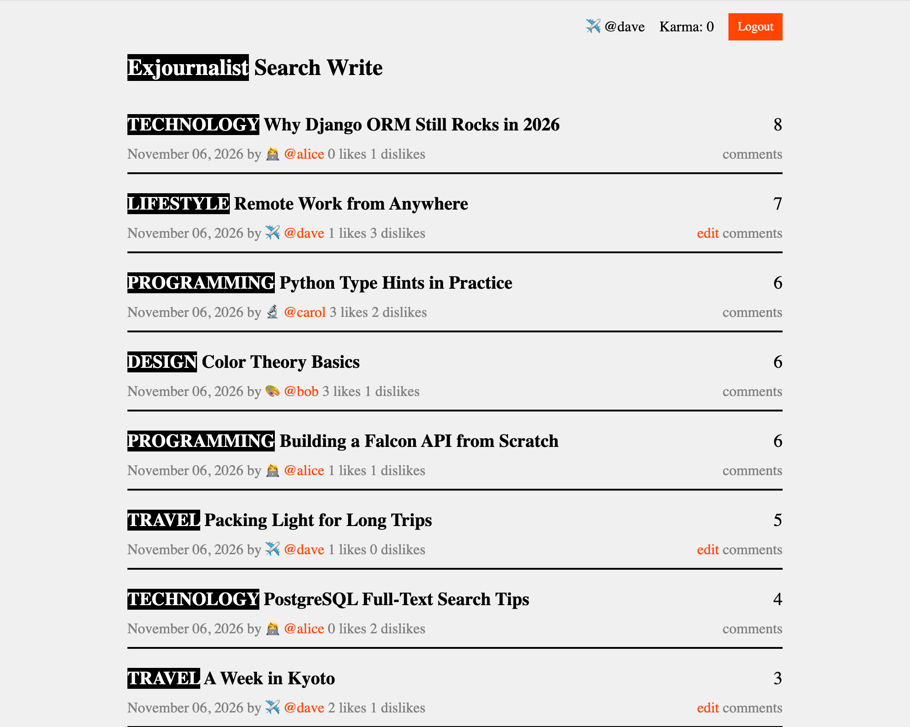

# Exjournalist



An online journaling and publishing platform built with:
- **Falcon** (WSGI web framework)
- **Django ORM** (PostgreSQL / SQLite database layer & migrations)
- **Jinja2** templates
- **Markdown** content rendering (with automatic heading normalization)

## Features

- **Encrypted Cookie Authentication**: Stores the authenticated user ID in a Fernet-encrypted `auth` cookie derived from `SECRET_KEY` (valid for 1 year) with Django PBKDF2 password hashing.
- **User Profiles & Settings** (`/users/new`, `/settings`, `/users/{username}`):
  - Username, password, emoji avatar, full name, email address, and Markdown bio.
- **Publishing & Editing** (`/articles/new`, `/articles/{id}`, `/articles/{id}/edit`):
  - Create and edit Markdown articles.
  - Each article belongs to one normalized category (lowercase `a-z` letters only, created on demand) with dedicated category feeds (`/categories/{name}`).
- **Full-Text Search** (`/search?q=`):
  - Searches across articles, categories, and authors.
- **Voting & Nested Comments** (`/articles/{id}/vote`, `/articles/{id}/comments`):
  - Per-user Like / Dislike toggle (`ArticleVote`) with live counters.
  - Threaded parent/child Markdown comments on articles.

## Setup

1. Create and activate a virtual environment:

```bash
python3 -m venv venv
source venv/bin/activate
```

2. Install dependencies:

```bash
pip install -r requirements.txt
```

3. Configure environment variables in `.env` (loaded via `python-dotenv` in `app/config.py`):

```ini
DEBUG=True
SECRET_KEY=replace-with-a-strong-secret-key
DATABASE_URL=postgresql://localhost:6432/exjournalist
```
*(Both `postgresql://` and `sqlite:///db.sqlite3` schemes are supported in `app/django_settings.py`.)*

4. Run database migrations:

```bash
python3 manage.py makemigrations app
python3 manage.py migrate
```

5. Start the server with Gunicorn:

```bash
gunicorn main:app -c gunicorn.conf.py
```

6. Open `http://127.0.0.1:8000` (production deployments use `exj.service` and `exj.conf`).
